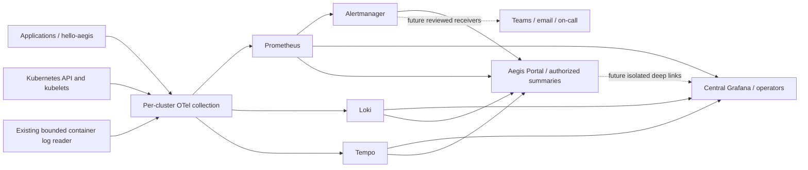

# Central Grafana: discovery, architecture and local runbook

Status: Phase 1 assessment and Phase 2 source candidate with real isolated Grafana
provisioning verification. No cluster admission, application deployment, AWS change,
production readiness or tenant isolation is claimed. Existing uncommitted monitoring
work was preserved and extended. See [verification](grafana-verification.md).

## Verified current state

The relevant sibling repositories are `aegis-platform`, `aegis-gitops`,
`aegis-portal`, `aegis-portal-workflows`, `aegis-cicd` and `hello-aegis`.
The platform already has a deterministic seven-image telemetry plan, fixed public
trust policy, local retention/storage budgets, read-only authenticated nginx query
sidecars, collector configuration, log reader, Prometheus rules and Alertmanager.
The portal already has server-authorized metrics, logs, traces and alerts pages.
`hello-aegis/app/telemetry.py` already emits bounded HTTP counters, latency histograms,
heartbeat, sanitized logs, server spans and optional client spans. Reuse these.

Docker inventory confirmed `aegis-dev-control-plane` is running. Read-only kubectl
inside that container confirmed healthy `hello-aegis` and portal workloads, Argo CD,
and sample applications. There is no `aegis-observability` namespace, service or pod.
Backend reachability and real ingestion therefore cannot be established. Do not
mistake image availability or configuration tests for deployed services.

Host kubeconfig has EKS and Docker Desktop contexts, with EKS selected. It has no
Kind context. No host-context kubectl requests, AWS API calls or context changes were
made. Discovery used `docker exec aegis-dev-control-plane kubectl
--kubeconfig=/etc/kubernetes/admin.conf get pods,services -A` only.

## HLD and decisions



ADR-01: one central local Grafana instance in the existing observability namespace.
It queries the existing authenticated service gateways and owns no backend storage
or telemetry collection. A separate add-on renderer leaves the seven-image policy,
its review hash and operational application configurations intact. Grafana is outside
the original backend manifest directory: the existing Argo Application will not silently
pick it up. No new automatic sync or admission exception is introduced.

ADR-02: initial Grafana access is exclusively for trusted platform operators with
cross-application responsibility. Disable anonymous login, signup, organization creation,
embedding and Grafana alert evaluation. Mount private admin/encryption keys; resolve
backend query capability on the server through secretKeyRef and secureJsonData.
The query capability grants cluster-wide reads; it is unsuitable for developers.
Keep existing server-side portal authorization as the developer entry point.

ADR-03: production preference is one central Amazon Managed Grafana workspace for
platform operations, conditional on identity, private networking, compliance and cost
review. [IAM Identity Center federation](https://docs.aws.amazon.com/grafana/latest/userguide/authentication-in-AMG-SSO.html)
and [VPC data source connectivity](https://docs.aws.amazon.com/grafana/latest/userguide/AMG-configure-vpc.html)
reduce identity and control-plane operations. VPC data source connectivity does not
by itself make browser access private: approve workspace network access controls and
VPN/private access separately. Existing `.svc.cluster.local` URLs will not resolve from
Managed Grafana; provide approved private DNS and authenticated TLS gateways.

An alternative is self-hosted Grafana in a dedicated management cluster with enterprise
OIDC, TLS ingress, policy-enforcing CNI, durable PostgreSQL, backups and on-call ownership.
It gives control over release cadence and provisioning but requires patching, HA,
database operations, audit collection and recovery testing. OSS removes license fees
but incurs compute/storage/operations costs. Managed Grafana adds active-user/workspace
charges; [AWS pricing](https://aws.amazon.com/grafana/pricing/) lists $9 per active
editor/admin and $5 per viewer monthly, minimum one editor per workspace, with service
identity and optional enterprise costs. Recheck region, features and pricing at approval.
Backend storage, traffic and ingestion charges remain separate in both designs.

## Security and isolation boundary

Grafana organization users can query data sources even when dashboards do not expose
them. [Grafana roles](https://grafana.com/docs/grafana/latest/administration/roles-and-permissions/)
and [security guidance](https://grafana.com/docs/grafana/latest/setup-grafana/configure-security/)
explain this boundary. Folders, dashboard variables, hidden Explore, fixed URLs and
read-only dashboards cannot enforce application/environment isolation.

This implementation intentionally grants no developer identity or browser portal link
to the shared Grafana. NetworkPolicy denies pod ingress where enforced, ClusterIP avoids
public exposure, and local operator port-forward retains authenticated login. Default
Kind networking may not enforce NetworkPolicy. Local in-cluster gateway transport is
HTTP with basic authentication; treat it as a development exception. Require authenticated
TLS/private transport before using any production or cross-cluster route.

For developer Grafana access, require separate organizations/data sources with enforced
backend tenants, or separate instances where backend enforcement cannot be proven.
Never give such data sources the current unrestricted query capability. Prometheus needs
an enforcing query gateway or independently scoped store; Loki and Tempo need enforced
tenant headers with read and ingest credentials that cannot select another tenant.
A shared central operator workspace may remain separately privileged. Enterprise data
source permissions alone do not create label-level isolation within a shared source.

Required negative tests before enabling links: two applications in DEV/STAGING/PROD;
modify dashboard variables; remove selectors; submit raw PromQL, LogQL and TraceQL via
Explore and `/api/ds/query`; call data source proxy, trace-by-ID and backend APIs directly;
try another tenant header; check anonymous, expired/revoked tokens and forged resource
attributes. Every unauthorized request must fail or produce zero foreign data. Record
actual results for each principal. This suite is pending; the operator-only test is not
cross-tenant verification. No browser/backend query credentials are added to the portal.

## Provisioning and dashboard inventory

Source assets are under `src/aegis_platform/grafana/`. JSON-compatible YAML provisions
Prometheus, Loki and Tempo through authenticated `:8080` gateways. Environment expansion
uses `$AEGIS_QUERY_PASSWORD`; Grafana macro dollars are escaped as `$$` in provisioning
files. No plugins or telemetry backend replacements are installed. The gateway changes
allow only bounded GET query/discovery endpoints and preserve write/unknown-path denial.

Six dashboards cover platform, Kubernetes, golden signals, delivery, investigation and
future AgentOps. Cluster and namespace selectors are navigation filters. Metrics-to-logs
links preserve those selections. Loki structured request `trace_id` links to Tempo;
Tempo span-to-logs uses cluster/namespace tags and a trace-ID body filter. Correlation
requires actual logs and matching resource attributes; container logs without trace IDs
cannot provide request correlation. Trace IDs are never indexed labels.

Panels use metrics configured by the existing collector/app candidate. All dashboards
carry a visible unverified-telemetry banner. Node condition readiness uses the configured
`node_conditions_to_report`; desired/available replicas and restarts come from k8s_cluster.
Requests/latency require the instrumented hello-aegis release. No catalog application
count, Argo CD sync, rollout duration, deployment frequency or AI/token/cost metric is
invented. Future panels explicitly explain missing instrumentation. No-data is unknown,
not zero/healthy; pod readiness is not an external availability SLI. Verify exact exported
series names/units against the pinned collector before accepting each live panel.

## Generate and review a candidate

From `aegis-platform`:

```sh
PYTHONPATH=src .venv/bin/python -m aegis_platform.grafana \
  --policy policies/observability.json \
  --revision FULL_REVIEWED_PLATFORM_COMMIT_SHA \
  --output .local/grafana-candidate
.venv/bin/python -m pytest -q
PYTHONPATH=src .venv/bin/python -m tooling.check_grafana
PYTHONPATH=src .venv/bin/python -m tooling.check_observability
```

The image is immutable and the review record binds revision, policy hash and resource
hash. Rendering does not prove that a revision contains the working tree: regenerate
from the exact reviewed clean checkout before admission. A local placeholder revision
must never be admitted. Trusted exact-plan admission and bootstrap are now implemented in
`tooling/observability_service.py` and `tooling/bootstrap_observability.py`. They must be
reviewed and published before activation; see [activation controls](observability-activation.md).

The checked image is the locally cached Grafana 11.5.2 digest. It provides reproducible
compatibility evidence only; it has not passed current CVE/support review. Do not deploy
this image in production. A supported patched digest requires a new reviewed change and
rerunning these checks. Docker checks use `--pull=never`, network none, read-only root,
no published port, synthetic credentials and temporary data. CI explicitly pulls the
same digest and runs the provisioning/authentication smoke after structural tests.

After trusted admission exists, the reviewed GitOps PR should include the exact generated
add-on resources and update the approved platform-service path/project ownership through
normal controls. Do not `kubectl apply` the local candidate to bypass approval. No action
here changes the existing working applications or their Argo configurations.

Private bootstrap prerequisites: existing `aegis-observability-auth/query-password`,
`telemetry-runtime` ServiceAccount, and separate `aegis-grafana-auth` with strong independent
`admin-password` and stable `secret-key` values. Use protected mounted secret files or the
approved secret manager. Never put plaintext/generated credentials in Git or shell history.
The plan contains references only. The combined service plan also binds ConfigMap hashes
to pod-template annotations so reviewed configuration changes trigger rollouts. Resource quotas must include the extra 100m/128Mi request,
500m/512Mi limit and pod. The standalone Grafana add-on still requires an approved rollout for subPath mounts;
the combined service renderer automates that rollout through its configuration hash. Grafana's local SQLite/plugins/session state is intentionally ephemeral;
provisioned dashboards survive as source, local users/state do not. No extra PVC is consumed.

## Alert ownership and gaps

Prometheus owns rule evaluation. Alertmanager owns grouping, routing and silences.
Incident tooling owns acknowledgement/escalation after integration. Grafana Alerting
is disabled to avoid duplicate evaluation. Existing receiver `portal` has no notification
integration; viewing API alerts is not Teams/email delivery or acknowledgement.

Ten candidate rules now cover HTTP error ratio, pod readiness, deployment unavailable,
CrashLoopBackOff, recent restart counts, high p95 latency with a traffic floor, node
pressure, collector/exporter scrape failure and backend scrape failure. The collector
explicitly enables container status/reason metrics; authenticated Prometheus targets
cover the existing backend gateways. Native validators accept the collector and all ten
rules. Live series/label output, threshold suitability and routing remain unverified.
Restart counts are a resettable gauge, not a counter for deployment-frequency inference.

Each rule includes a local operator Grafana URL using loopback port 3000 and cluster/
namespace filters. After approved activation, forward that port explicitly. Replace the
base URL through a reviewed configuration change before any production routing. These
local links are not developer grants. Promtool fixtures verify HTTP error firing/clearing;
additional scenario fixtures and real failure injection remain necessary before activation.

The existing Alertmanager receiver still has no Teams/email/on-call integration. Review
routing with secrets in the approved secret store, then prove firing, grouping, delivery,
acknowledgement and silences against an isolated test receiver. Do not infer notifications
from successful rule validation or portal alert display.

## Operations and failure verification

After approved local activation, explicitly target the local Kind context and forward
Grafana to loopback only. Confirm `/api/health`, authenticated dashboard GETs and each data
source health endpoint. Generate approved normal and error requests to hello-aegis;
wait for metric export/scrape and log batches. Query the heartbeat and request histogram,
Loki namespace/cluster selector, Tempo search and a returned trace ID. Follow metric-to-log,
log-to-trace and trace-to-log links. Record timestamps, series names and sanitized evidence.
A healthy Grafana database does not prove these checks.

For missing panels, inspect approved collector/gateway readiness, app release instrumentation,
resource identity and export counters. Check 401 (capability/rotation), 404 (unsupported path),
no series (ingestion/instrumentation) and stale timestamps separately. Collector failure:
stop an isolated test collector, verify scrape/heartbeat stale behavior and alert transitions,
restore, verify ingestion resumes. Backend downtime: isolate one backend in a test environment,
verify Grafana reports errors rather than healthy zeros, ensure other sources still work,
restore and verify retention. No destructive failure injection was performed on the live cluster.

For rollback, revert the reviewed Grafana add-on commit through GitOps; leave telemetry
backends/application deployments intact. For password rotation, coordinate the private
query secret with its existing policy fingerprint and roll dependent clients; rotate
Grafana encryption key only with a migration/reprovisioning plan. Remove expired sessions
and inspect access/audit evidence. Central audit export and SSO remain production prerequisites.

## EKS and hardening prerequisites

Do not reuse the single-node Kind collector profile for EKS. Use one cluster receiver
Deployment (leader election/one active instance), one kubelet/log collector per node,
and a separate scalable OTLP gateway as needed. Avoid running k8s_cluster in every agent.
Associate pod identities at trusted ingress, overwrite untrusted cluster/application labels,
apply namespace/team/environment identity from enrollment, cap resource attributes and
sampling, and reject tenant spoofing. Required work includes EKS enrollment/IRSA or Pod
Identity, scoped RBAC, private DNS/routing/security groups, authenticated TLS ingest/query,
CA and secret rotation, network policy enforcement and real cross-cluster/isolation tests.
No EKS manifests are presented as deployable until these details are approved.

Production also needs HA Grafana/database, backend HA/object storage, encrypted backups,
RPO/RTO and restore exercises, supported image/security scanning, identity provider group
mapping, least-privilege service accounts, audit retention, and reviewed retention/ingestion
budgets. Existing development backends retain 24h with small bounded storage/ingestion;
production retention and disaster recovery cannot inherit these defaults accidentally.
Track series cardinality, daily log bytes, spans/s, token dimensions, query load, storage
and inter-VPC transfer. Assign platform ownership for shared dashboards and team ownership
for app SLIs. Tune alert traffic floors, grouping, inhibition and escalation from real data.
Portal deep links and production SSO are later phases gated by backend isolation verification.
